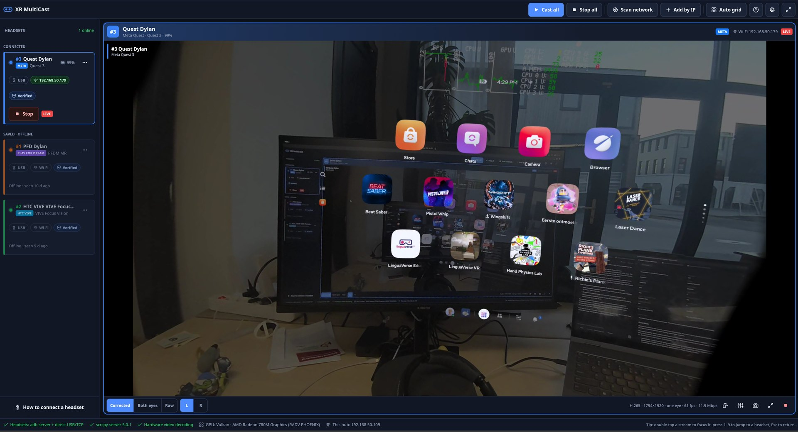
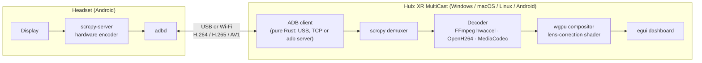

# XR MultiCast

**Cast every standalone VR headset in the room to one screen: lens-corrected, clearly labelled, over USB or Wi-Fi.**

[](LICENSE)
[](https://github.com/smitdylan2001/xr-multicast/releases/latest)
[](#download-and-install)
[](#building-from-source)



XR MultiCast mirrors standalone VR headsets (Meta Quest, PICO, Play For Dream, HTC VIVE, Android XR) into one dashboard. It is built for classrooms, demo booths, training sessions and labs: anywhere one person needs to see what several headset users are looking at.

Instead of the raw, barrel-distorted panel image, you get a **flat, natural view** of what the wearer sees. Each stream is labelled with the headset's number, name and colour.

It is a native app for **Windows, macOS and Linux** (including a **Raspberry Pi 5** or other single-board computer with a touchscreen as a dedicated hub), and for **Android phones and tablets**, which can be the hub themselves, with no PC. Everything runs locally: no cloud, no account, no Google `adb` to install.

XR MultiCast is free and open source (MIT), built and maintained by **[Dunk XR](https://dunktechnologies.com)** (Dunk Technologies), which also offers [whitelabel versions and custom hardware](#whitelabel--custom-hardware-by-dunk-xr) built on it.

> **Status: 2.0, the first native release.** Tested on Linux desktop with a real Meta Quest 3 (USB and Wi-Fi, H.265 hardware decoding, lens correction including Quest 3 panel tilt) and on Android emulators end to end. Play For Dream MR and VIVE Focus Vision headsets were tested with the earlier Electron app, which uses the same protocol; PICO and Android XR follow the same path but are untested. **Not yet verified on real hardware:** Raspberry Pi, native Windows and macOS runs, and an Android phone/tablet hosting a real headset over USB. Reports are very welcome; see [Contributing](#contributing).

## Contents

- [Features](#features)
- [Supported headsets](#supported-headsets)
- [Download and install](#download-and-install)
- [Setup guide](#setup-guide)
- [Usage tips](#usage-tips)
- [Raspberry Pi / kiosk hub](#raspberry-pi--kiosk-hub)
- [Android phone or tablet as the hub](#android-phone-or-tablet-as-the-hub)
- [Troubleshooting](#troubleshooting)
- [How it works](#how-it-works)
- [Building from source](#building-from-source)
- [Project layout](#project-layout)
- [Roadmap](#roadmap)
- [Contributing](#contributing)
- [Credits](#credits)
- [Whitelabel & custom hardware by Dunk XR](#whitelabel--custom-hardware-by-dunk-xr)
- [License](#license)

## Features

**Connecting**
- **Built-in ADB client.** XR MultiCast speaks the ADB protocol itself over USB and Wi-Fi, so you don't need to install Google's Platform-Tools. If an adb server is already running (SideQuest, Android Studio, Meta Quest Developer Hub), it uses that too and shares its key, so headsets that already trust this computer don't ask again.
- **USB-first verification.** A headset is plugged in once and verified by its hardware serial before it may cast. Unverified devices found on the network are listed but can't cast. On by default; can be turned off in Settings.
- **One-tap Wi-Fi.** Verifying can switch the headset to network debugging, so you can unplug the cable. Verified headsets reconnect over Wi-Fi automatically.
- **Find headsets on the network.** *Scan network* finds them by saved address, mDNS and a scan of the local subnet; *Add by IP* connects to one address.
- **Cast all.** One tap streams every verified headset. Dropped streams retry by themselves, and switch to Wi-Fi if the cable is pulled.

**Viewing**
- **Clear labels:** a number, name and colour per headset in the sidebar, the tile header and an overlay on the video. Each tile also shows a brand badge, model, connection, battery, codec, resolution, fps and bitrate.
- **View modes:** *Corrected* (one eye, lens distortion removed; the default), *Both eyes* (corrected stereo pair) and *Raw* (the panel image as the headset sends it).
- **Panel layout auto-detection:** the app works out from the video whether the eye views are side by side, stacked or a 2×2 grid (e.g. Play For Dream MR) and shows one upright eye.
- **Calibration per headset** with a live reference grid: barrel and edge correction (k1/k2), zoom, lens centre, **tilt** for canted panels (mirrored per eye; Quest 3 ships with a 25° preset), red/blue fringe correction, panel layout, eye, rotation, output framing and flips. Saved per headset.
- **Focus, grid and fullscreen:** double-tap a stream (or press `1`–`9`) to focus it, choose a grid, go fullscreen, rotate a stream, and save PNG snapshots.

**Video**
- **Codecs:** H.264, H.265 (HEVC) and AV1, with experimental 10-bit colour. *Auto* uses H.265 or AV1 only when the headset has a hardware encoder for it and this receiver can hardware-decode it; otherwise H.264. A stream that fails falls back to H.264 automatically.
- **Hardware decoding:** VA-API and V4L2 on Linux (incl. Raspberry Pi), D3D11VA/DXVA2 on Windows, VideoToolbox on macOS, MediaCodec on Android, with a per-stream software fallback.
- **Video codecs view:** the headset's hardware encoders next to this receiver's decoders in a green/amber/red matrix (8 and 10 bit), plus which codec the policy picks and why.
- **Resolution matched to the screen:** each headset streams only as many pixels as its tile shows (up to your quality preset), with the bitrate scaled to match. Small tiles cost far less bandwidth and decoding.
- **Stream one eye only:** the headset crops before encoding, giving about twice the sharpness at the same bandwidth.
- **Quality presets** or custom resolution, bitrate and fps, set separately for USB and Wi-Fi.
- **One GPU pass for all tiles** (wgpu: Vulkan, Metal, DirectX 12, or OpenGL as a fallback).

**Made for real rooms**
- **Status you can act on:** the status bar is green (fine), amber (works, with a caveat) or red (broken). Tap any amber or red item, a "Waiting for video" tile or a low battery for the explanation and the fix.
- **Touch-first UI** with large targets, a sidebar that becomes a drawer on narrow or portrait screens, and an adjustable interface size.
- **Kiosk mode** for wall displays and touchscreen hubs: fullscreen, no window decorations, quitting needs a confirmation.
- **Android standalone hub:** a phone or tablet hosts the headsets over USB-C or Wi-Fi; casting continues in the background.
- **Private by design:** everything stays on your local network. No cloud service, no account, no telemetry.

## Supported headsets

All supported headsets run Android, so the same pipeline works for every brand. Lens presets are starting points; fine-tune them with Calibrate.

| Brand | Recognised models | Notes |
| --- | --- | --- |
| **Meta** | Quest, Quest 2, Quest Pro, Quest 3, Quest 3S | Quest 3 preset includes its canted-panel tilt. Developer mode needs a free Meta developer account. |
| **PICO** | PICO 4, PICO 4 Ultra, Neo 3 | |
| **Play For Dream / YVR** | YVR 1/2, Play For Dream MR | MR's sideways micro-OLED panel is rotated automatically. |
| **HTC VIVE** | VIVE Focus 3, XR Elite, Focus Vision | |
| **Android XR** | Samsung Galaxy XR, and any device that reports `android.software.xr.*` | |
| **Other Android devices** | Phones, tablets, other headsets | Shown flat, without lens correction. |

## Download and install

Get the latest version from **[Releases](https://github.com/smitdylan2001/xr-multicast/releases/latest)**. Every release includes `SHA256SUMS.txt` for checking downloads.

| Platform | Download | Notes |
| --- | --- | --- |
| **Windows 10/11** (x64) | `xr-multicast-2.0.0-windows-x64-setup.exe` (installer) or `…-windows-x64.zip` (portable) | Includes FFmpeg (LGPL) for hardware decoding (D3D11VA) and H.265/AV1. |
| **macOS** (Apple Silicon and Intel) | `xr-multicast-2.0.0-macos-universal.dmg` | H.264 built in. `brew install ffmpeg` adds H.265/AV1 and VideoToolbox hardware decoding. |
| **Linux** x86_64 | `xr-multicast_2.0.0_amd64.deb` or `xr-multicast-2.0.0-linux-x86_64.tar.gz` | Uses the system FFmpeg plus VA-API; H.264 built in as a fallback. |
| **Linux** aarch64 (Raspberry Pi 5, other SBCs) | `xr-multicast_2.0.0_arm64.deb` or `xr-multicast-2.0.0-linux-aarch64.tar.gz` | Uses V4L2 / VA-API hardware decoding where available. |
| **Android 13+** phones and tablets | `xr-multicast-2.0.0-android-arm64-v8a.apk` (or `…-android-universal.apk`) | Standalone hub; needs Vulkan 1.1. |

iOS and iPadOS aren't supported: they can't host ADB connections.

### Windows

1. Run the `setup.exe` installer, or unzip the portable `.zip` anywhere and start XR MultiCast from that folder.
2. The builds aren't code-signed yet. If **SmartScreen** says "Windows protected your PC", click **More info → Run anyway**.
3. **For USB**, install the headset vendor's ADB driver, e.g. Meta's **Oculus ADB Drivers** from [developers.meta.com/horizon/downloads](https://developers.meta.com/horizon/downloads/), or the Google USB Driver for other brands. Wi-Fi casting needs no driver.

### macOS

1. Open the `.dmg` and drag **XR MultiCast** to Applications.
2. The app isn't notarised yet. The first time, **right-click it → Open → Open**, or run:
   ```bash
   xattr -dr com.apple.quarantine "/Applications/XR MultiCast.app"
   ```
3. Optional, for H.265/AV1 and hardware decoding: `brew install ffmpeg`. No USB driver is needed.

### Linux

**Debian / Ubuntu / Raspberry Pi OS:** `sudo apt install ./xr-multicast_2.0.0_amd64.deb` (or `_arm64.deb`). This also installs the USB rule for headsets.

**Any distribution (tarball, per-user, no root needed except for the USB rule):**

```bash
tar xzf xr-multicast-2.0.0-linux-x86_64.tar.gz
cd xr-multicast-2.0.0-linux-x86_64
./install.sh --udev            # app menu entry + USB rule for all ADB headsets (asks for sudo)
./install.sh --kiosk --udev    # …and start fullscreen at login (touchscreen hub)
./install.sh --uninstall
```

- **USB access:** the rule ([`70-xr-multicast-adb.rules`](packaging/linux/70-xr-multicast-adb.rules)) matches the standard ADB USB interface, so every headset brand works, including models missing from `android-udev-rules`.
- **Video decoding:** XR MultiCast loads the system FFmpeg (libavcodec 59–62, i.e. FFmpeg 5–8), which most desktops already have. If H.265/AV1 show as unsupported, install it, e.g. `sudo apt install libavcodec-extra` (Ubuntu) or `ffmpeg-libs` from RPM Fusion (Fedora). For hardware decoding, install your GPU's VA-API driver (`mesa-va-drivers`, `intel-media-va-driver`). H.264 always works through the built-in OpenH264 decoder.

### Android

Install the APK (allow "install unknown apps" for your browser or file manager). Use `arm64-v8a` for phones and tablets; the `universal` APK also runs on x86_64 emulators. See [Android phone or tablet as the hub](#android-phone-or-tablet-as-the-hub).

## Setup guide

The in-app **How to connect a headset** guide (bottom of the sidebar) has these steps per brand.

### 1. Enable developer mode / USB debugging

| Brand | Steps |
| --- | --- |
| **Meta Quest** | Sign in at [developers.meta.com](https://developers.meta.com) and create or join an organisation (free). In the **Meta Horizon** phone app: Menu → Devices → your headset → Headset settings → **Developer mode** → On. Reboot the headset. *Windows:* install the Oculus ADB Drivers. |
| **PICO** | Settings → General → About → tap **Software Version** 7 times until Developer options appear. Then Settings → Developer → enable **USB Debugging**. |
| **Play For Dream / YVR** | Settings → About → tap the build / version number 7 times. Open Developer options and enable **USB debugging**. |
| **HTC VIVE** | Settings → Advanced (or About) → tap **Build number** / version 7 times. Open Developer options and enable **USB debugging**. |
| **Android XR** (Galaxy XR) | Settings → About → Software information → tap **Build number** 7 times. Then Settings → Developer options → enable **USB debugging**. |
| **Other Android** | Settings → About → tap **Build number** 7 times, then Developer options → **USB debugging**. |

### 2. First connection over USB, and Verify

1. Plug the headset into the hub with a USB-C **data** cable (charge-only cables don't work).
2. Put the headset on and accept **Allow USB debugging**. Tick **Always allow from this computer**.
3. The headset appears under *Connected* in the sidebar. Tap **Verify**, give it a clear name and colour, and keep **Enable Wi-Fi casting** ticked.

Verifying stores the headset's hardware serial; only verified headsets may cast (Settings → Security).

### 3. Wi-Fi casting

With *Enable Wi-Fi casting* ticked, Verify switches the headset to network debugging. Unplug the cable: the headset stays listed **via Wi-Fi** and reconnects automatically while it's on the same network as the hub.

- Network debugging resets when the headset **reboots**. Plug it in once more and tap **Enable Wi-Fi** in its menu.
- *Scan network* finds headsets that are already in network-debugging mode; *Add by IP* connects to `ip[:port]` (default port 5555).
- The hub and headsets must be on the same subnet. Guest networks and "client isolation" block this.

### 4. Cast

Tap **Cast** on a headset, or **Cast all** in the toolbar. A tile shows *Waiting for video…* until the first picture arrives; put the headset on (its display must be awake). Settings → *Start casting automatically when a verified headset connects* makes this hands-free.

### 5. Calibrate (optional)

Open a tile's menu → **Calibrate**. Turn on the reference grid and adjust until straight lines in the headset look straight:

- **Barrel correction (k1)** and **Edge correction (k2)** remove the lens pre-distortion; **Zoom** fills the frame.
- **Lens centre X/Y** if the picture is off-centre; **Tilt** if the horizon is rolled (canted panels).
- **Red / Blue fringe** for colour fringes at the edges.
- **Panel layout**, **Eye**, **Rotation** and **Output framing** if auto-detection picks the wrong arrangement.

**Save** stores it for that headset; **Reset to preset** goes back to the brand/model default. Please share values that work well for your model ([how](CONTRIBUTING.md#sharing-calibration-presets)).

## Usage tips

| Input | Action |
| --- | --- |
| Double-tap / double-click a tile | Focus that stream (again to return to the grid) |
| `1`–`9` | Focus headset number 1–9 |
| `Esc` | Leave fullscreen focus, close calibration or the drawer, or return to the grid |
| `F11` | Toggle fullscreen (not in kiosk mode) |
| Tap a tile's stats line | Open the Video codecs view for that headset |

**Command-line flags** (`xr-multicast --help`):

| Flag | Meaning |
| --- | --- |
| `--kiosk` | Touchscreen hub: fullscreen, no window decorations, quitting needs a confirmation (Settings → Quit…). |
| `--fullscreen` | Start fullscreen. |
| `--ui-scale X` | Interface size on top of the display scaling, e.g. `1.5` (also in Settings → Display). |
| `--connect ADDR` | Connect to `ip[:port]` on start. Repeatable. |
| `--renderer auto\|vulkan\|gl` | GPU backend. `auto` prefers Vulkan/Metal/DX12 and falls back to OpenGL. |
| `--no-adb-server` | Don't use a running adb server; talk to headsets over USB and TCP directly. |
| `--no-usb` | Don't open USB devices directly (leave USB to an adb server). |
| `--demo N` | Show N synthetic headsets (try the UI without hardware). |
| `--size WxH` | Initial window size. |
| `--decoder-threads N` | Software decoder threads per stream (0 = automatic). |
| `--store PATH`, `--adb-key PATH`, `--scrcpy-server PATH` | Use other settings, key or scrcpy-server files. |

**Environment variables:** `XRMC_HWDEC=0` turns off hardware decoding; `XRMC_FFMPEG_DIR` points at another FFmpeg; `RUST_LOG=debug` gives verbose logs. More in [crates/xrmc-decode](crates/xrmc-decode/README.md).

**Settings** (and the list of verified headsets) live in `xr-multicast.json` in `~/.config/XR MultiCast/` (Linux), `%APPDATA%\XR MultiCast\` (Windows) or `~/Library/Application Support/XR MultiCast/` (macOS), next to the hub's ADB key `adbkey`. The file is compatible with the 1.x Electron app.

## Raspberry Pi / kiosk hub

A Raspberry Pi 5 (or similar aarch64 board) with a touchscreen makes a self-contained casting station.

1. Use 64-bit **Raspberry Pi OS Bookworm** or newer (glibc 2.36+).
2. Install the `arm64` `.deb`, or unpack the `linux-aarch64` tarball and run `./install.sh --kiosk --udev`. `--kiosk` adds an autostart entry, so the dashboard opens fullscreen at login.
3. Enable desktop auto-login (`sudo raspi-config` → System → Boot / Auto Login).
4. Plug headsets into the Pi's USB ports once to verify them, then cast over Wi-Fi. Use 5 GHz Wi-Fi or Ethernet for the hub.

Tips:
- Hardware decoding: the Pi 5 decodes **H.265** in hardware (V4L2 request API, with Raspberry Pi's FFmpeg); it has no H.264 hardware decoder, so H.264 is decoded in software. *Auto* codec choice and resolution matching keep the load down. Check the Video codecs view to see what the board offers.
- A small screen? Raise the interface size (`--ui-scale 1.25` or Settings → Display).
- If Vulkan misbehaves on the board's driver, start with `--renderer gl`.
- Kiosk mode quits only via Settings → Quit… (with confirmation). To stop the autostart, remove the XR MultiCast entry in `~/.config/autostart/`.

> Raspberry Pi support is built and packaged but not yet verified on real hardware. Reports welcome.

## Android phone or tablet as the hub

The Android app is a complete hub: its own ADB client, scrcpy, MediaCodec decoding and the same UI. No PC is involved.

- **Requirements:** Android 13 or newer with Vulkan 1.1 (most phones and tablets from 2020 on).
- **USB (OTG):** connect the headset to the phone/tablet's USB-C port with a USB-C to USB-C data cable or an OTG adapter. Android asks whether XR MultiCast may access the device: tap **OK** (tick "Always open" to skip this next time). The app opens automatically when a headset is plugged in. Then accept **Allow USB debugging** in the headset and tap **Verify**. For several headsets, use a powered USB-C hub.
- **Wi-Fi:** verify over USB with *Enable Wi-Fi casting* ticked, then unplug; or use *Scan network* / *Add by IP* for headsets already in network-debugging mode. The app holds a Wi-Fi multicast lock while scanning so mDNS discovery works.
- **Permissions:** allow notifications. While streams are shown, a foreground-service notification keeps casting alive when you switch apps; without it Android cuts a background app's network after a few seconds.
- The screen stays on while casting; the back button closes dialogs and drawers.

> The USB host path is wired up and tested in code, but not yet with a real headset plugged into a phone (emulators have no USB host). Wi-Fi casting was tested end to end between emulators.

## Troubleshooting

Start with the **status bar**: tap any amber or red item for the cause and fix.

| Problem | Fix |
| --- | --- |
| **Headset not listed** | Use a USB-C *data* cable; try another port. Make sure USB debugging is on (see [Setup guide](#setup-guide)). Put the headset on: the debugging prompt may be waiting. |
| **"no permissions" / access denied (Linux)** | Install the USB rule: `./install.sh --udev` (the `.deb` does this), then re-plug the headset. |
| **Not detected over USB (Windows)** | Install the vendor's ADB driver (Oculus ADB Drivers for Quest; Google USB Driver or the OEM driver otherwise). Or run an adb server (e.g. from Meta Quest Developer Hub): XR MultiCast uses it automatically. |
| **"Allow USB debugging" keeps appearing** | Tick *Always allow from this computer*. The hub's key is `adbkey` next to the settings file; keep it when reinstalling. |
| **Tile says "Waiting for video…"** | The headset sends no picture while its display is off. Put it on or wake it, and accept *Allow USB debugging* if it's asking. The stream picks up by itself. |
| **Wi-Fi casting stopped after a reboot** | Network debugging resets on reboot. Plug in once and tap *Enable Wi-Fi*. |
| **Scan network finds nothing** | Hub and headsets must share a subnet; guest networks and client isolation block discovery. |
| **H.265 / AV1 unavailable, or "No video decoder"** | Install FFmpeg: `brew install ffmpeg` (macOS), `sudo apt install libavcodec-extra` (Debian/Ubuntu). Windows builds include it. H.264 works without it. |
| **"Video is decoded in software"** | Install your GPU's VA-API driver (Linux), or keep resolution matching on and lower the quality preset. |
| **Blank window, crash at start, or GPU errors** | Start with `xr-multicast --renderer gl` to use OpenGL instead of Vulkan/Metal/DX12. |
| **Sideways or upside-down image** | Use the rotate button on the tile (saved per headset), and please report the right angle for your model. |
| **macOS: "can't be opened because Apple cannot check it"** | Right-click the app → Open, or `xattr -dr com.apple.quarantine "/Applications/XR MultiCast.app"`. |
| **Windows: SmartScreen warning** | More info → Run anyway (the builds aren't code-signed yet). |

## How it works



1. **ADB.** The hub's own ADB client (`xrmc-adb`: RSA auth, USB via `nusb`, TCP, or a running adb server) connects to each headset's `adbd`.
2. **scrcpy.** It pushes **[scrcpy-server](https://github.com/Genymobile/scrcpy)** (pinned v5.0.1) to the headset, which captures the display and encodes it with the headset's hardware encoder. XR MultiCast implements the scrcpy client protocol itself (`xrmc-scrcpy`) and opens the video socket through ADB directly, without port forwarding.
3. **Decoding.** `xrmc-decode` decodes H.264/H.265/AV1 with FFmpeg's hardware decoders (loaded at runtime), OpenH264, or Android MediaCodec.
4. **Lens correction.** `xrmc-render` draws every tile in one wgpu pass. For each output pixel at radius *r* from the lens axis, the shader samples the panel at `r_src = r · (1 + k1·r² + k2·r⁴) · s_channel`, with `s_channel` correcting red and blue fringing, after rotating by the per-eye tilt.
5. **Policy.** `xrmc-core` handles device trust, discovery, layout detection, codec choice and resolution matching; `xrmc-hub` wires it to real devices; the egui app in `apps/xrmc-desktop` is the UI on every platform.

More detail: [docs/rust-core.md](docs/rust-core.md) (architecture), [docs/ui-choice.md](docs/ui-choice.md) (why egui + wgpu), [crates/xrmc-decode](crates/xrmc-decode/README.md) (decoding).

## Building from source

Requirements: the Rust toolchain from [`rust-toolchain.toml`](rust-toolchain.toml) (installed automatically by `rustup`), a C compiler, and the scrcpy-server v5.0.1 file.

```bash
git clone https://github.com/smitdylan2001/xr-multicast.git
cd xr-multicast
# scrcpy-server: either `npm install && npm run setup` (downloads it into vendor/), or download
# scrcpy-server-v5.0.1 from https://github.com/Genymobile/scrcpy/releases and save it as vendor/scrcpy-server
cargo run -p xrmc-desktop --release                # real headsets
cargo run -p xrmc-desktop --release -- --demo 9    # 9 synthetic headsets, no hardware needed
cargo test --workspace
```

- **Linux** builds compile OpenH264 from source, so they need a C/C++ compiler (`build-essential`). FFmpeg, Vulkan and the windowing libraries are loaded at runtime, so no development headers are needed.
- **Packaging:** scripts are in [`packaging/native/`](packaging/native/) (e.g. `packaging/native/build-linux.sh x86_64|aarch64`; aarch64 is cross-built with `cargo-zigbuild`). Pushing a `v*` tag builds every platform on GitHub Actions and attaches the packages to a release.
- **Android:** `apps/xrmc-android/build.sh` (needs `cargo-ndk`, Android SDK 36, NDK r27, JDK 17); see [apps/xrmc-android/README.md](apps/xrmc-android/README.md).
- **Command-line tool:** `cargo run -p xrmc-cli -- --help` exercises the core without a UI (`devices`, `info`, `encoders`, `stream`, `hub`).

## Project layout

```
crates/
  xrmc-adb/       ADB client: wire protocol, RSA auth, USB (nusb / Android fd), TCP, adb-server
  xrmc-scrcpy/    scrcpy-server v5.0.1 arguments, protocol demuxer, encoder list, sessions
  xrmc-media/     H.264/H.265/AV1 bitstream parsing, fMP4 muxing
  xrmc-core/      brands and lens presets, layout detection, codec/resolution policy, settings,
                  discovery, device and stream managers
  xrmc-hub/       the core wired to real ADB and scrcpy sessions
  xrmc-decode/    FFmpeg (runtime-loaded, hwaccels), OpenH264, Android MediaCodec
  xrmc-render/    wgpu compositor and lens-correction shader (WGSL)
  xrmc-cli/       `xrmc` command-line tool
apps/
  xrmc-desktop/   the egui app (`xr-multicast`), also the UI library for Android
  xrmc-android/   Android hub app (GameActivity + Vulkan, Java shell for USB host)
packaging/        native packaging scripts, Linux installer and udev rule
docs/             architecture, UI choice, remote API
src/, test/       legacy Electron app (1.x), see below
```

**Legacy Electron app.** The 1.x Electron app stays in `src/` (`npm install && npm start`). It isn't released anymore, but it still provides the **tablet/browser dashboard** (iPads, phones) and the **[remote WebSocket API](docs/remote-api.md)** until those are ported to the native app. Brand data is shared: [`src/shared/brands.js`](src/shared/brands.js) is exported to `crates/xrmc-core/data/brands.json`.

## Roadmap

- **Remote dashboard and API in the native app:** tablets and browsers as viewers, and the [WebSocket API](docs/remote-api.md) for hardware controls and automation (wire-compatible with 1.x).
- **Zero-copy decoding:** hardware frames straight into the GPU compositor (Android `AHardwareBuffer`, VA-API/DMA-BUF, D3D11, VideoToolbox).
- **Android 11+ wireless-debugging pairing** (pairing codes over TLS), so Wi-Fi works without a first USB connection.
- **Signed and notarised builds** for Windows and macOS.
- **Headless hub** for screenless hub boxes.
- More verified headset presets from real-hardware testing.

## Contributing

Issues and pull requests are welcome; see **[CONTRIBUTING.md](CONTRIBUTING.md)**. Especially useful:

- **Headset reports** (model, OS, what works) via the [headset support template](https://github.com/smitdylan2001/xr-multicast/issues/new?template=headset_support.yml), ideally with a *Raw* snapshot.
- **Calibration values** that make lines straight on your model.
- Testing on Windows, macOS, Raspberry Pi and Android phones/tablets with real headsets.

Please follow the [Code of Conduct](CODE_OF_CONDUCT.md) and report security issues privately ([SECURITY.md](SECURITY.md)). Release notes are in [CHANGELOG.md](CHANGELOG.md).

## Credits

XR MultiCast stands on the shoulders of great open-source projects:

- **[scrcpy](https://github.com/Genymobile/scrcpy)** by Genymobile and Romain Vimont (Apache-2.0). Its server runs on each headset and is bundled unmodified.
- **[FFmpeg](https://ffmpeg.org)** (LGPL-2.1+), loaded at runtime for H.265/AV1 and hardware decoding; bundled as shared libraries on Windows.
- **[OpenH264](https://github.com/cisco/openh264)** by Cisco (BSD-2-Clause), the built-in H.264 decoder, via [openh264-rs](https://github.com/ralfbiedert/openh264-rs).
- **[egui / eframe](https://github.com/emilk/egui)** (MIT/Apache-2.0) for the UI, with its bundled fonts (Ubuntu Font Licence, OFL, MIT).
- **[wgpu](https://github.com/gfx-rs/wgpu)** (MIT/Apache-2.0) for rendering, **[winit](https://github.com/rust-windowing/winit)** (Apache-2.0) for windows and input, **[AccessKit](https://github.com/AccessKit/accesskit)** for accessibility.
- **[tokio](https://tokio.rs)** (MIT), **[nusb](https://github.com/kevinmehall/nusb)** (USB), **[RustCrypto `rsa`/`sha1`/`sha2`](https://github.com/RustCrypto)** (ADB auth), **[mdns-sd](https://github.com/keepsimple1/mdns-sd)** (discovery), **[libloading](https://github.com/nagisa/rust_libloading)** (ISC), **[clap](https://github.com/clap-rs/clap)**, **[serde](https://serde.rs)**, **[tracing](https://github.com/tokio-rs/tracing)**, **[image](https://github.com/image-rs/image)**.
- **Android:** [android-activity](https://github.com/rust-mobile/android-activity) with Google's **GameActivity** (Apache-2.0), the **Android NDK** (MediaCodec), [ndk](https://github.com/rust-mobile/ndk) and [jni](https://github.com/jni-rs/jni-rs).
- **[Electron](https://www.electronjs.org)** for the legacy 1.x app.

The full list of components, versions and licences is in **[THIRD_PARTY_NOTICES.md](THIRD_PARTY_NOTICES.md)** (regenerate with `python3 scripts/third-party-notices.py`).

## Whitelabel & custom hardware by Dunk XR

XR MultiCast is developed by **[Dunk XR](https://dunktechnologies.com)**, the immersive-technology studio of **Dunk Technologies**. Dunk XR has over seven years of hands-on VR and AR development experience and provides:

- **Immersive development:** custom VR, AR and MR applications for training, education, healthcare, events and entertainment.
- **Workshops:** hands-on sessions from VR basics to advanced AR techniques, tailored to your team.
- **Consultancy:** expert guidance to get immersive projects unstuck and shipped.

**Built on XR MultiCast:**

- **Whitelabel versions:** XR MultiCast under your own brand, with your name, logo and colours, preconfigured for your headsets and venues, and installers you can distribute to your customers.
- **Custom hardware solutions:** turnkey multi-headset casting stations. Examples include dedicated hub computers and Raspberry Pi touchscreen hubs, wall-display and kiosk setups, physical control panels (cast-all buttons, headset selectors, status lights) and charging/storage carts with integrated casting.
- **Integrations and custom features:** connecting XR MultiCast to your LMS, session software or venue systems through the [remote API](docs/remote-api.md), or adding features for your use case.

Get in touch: **[info@dunktechnologies.com](mailto:info@dunktechnologies.com)** · [dunktechnologies.com](https://dunktechnologies.com) · [LinkedIn](https://www.linkedin.com/in/smitdylan/)

## License

XR MultiCast is released under the [MIT License](LICENSE). © 2026 Dylan Smit (Dunk Technologies). Third-party components keep their own licences; see [THIRD_PARTY_NOTICES.md](THIRD_PARTY_NOTICES.md).

**Trademarks:** Meta Quest, PICO, VIVE, Play For Dream, YVR, Galaxy XR and Android are trademarks of their respective owners. XR MultiCast is an independent project and is not affiliated with or endorsed by them.
